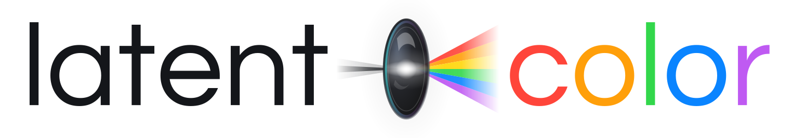

<p align="center">
  <picture>
    <source media="(prefers-color-scheme: dark)" srcset="assets/brand/latentcolor-banner-dark.svg">
    <source media="(prefers-color-scheme: light)" srcset="assets/brand/latentcolor-banner-light.svg">
    
  </picture>
</p>

# latentcolor extensions

[latentcolor](https://latentcolor.com) is a professional photo editor that runs locally in your browser. It offers a human-first UI alongside a full-featured programmatic interface for agents and scripts. 

This repository distributes the `latentcolor` CLI and plugins for Codex, Claude Code, and Cursor. Together, they let you collaborate with your preferred coding agent to create photos you love.

Currently everything is run locally on your computer (aside from any agents you choose to use). Future remote AI features will be optional, reserved for advanced workflows, and explicitly labeled. `latentcolor` does not collect or retain your image or usage data.

Visit [latentcolor.com](https://latentcolor.com).


## Quick start

1. [Set up the Latentcolor plugin and CLI](#install) on the computer where you edit photos.
2. Ask your agent to edit a local photo.

For example:

> Make this photo look better with latentcolor.

The agent opens `latentcolor` in your browser, where you can see the image and the result of each edit.

## Install

### Ask your agent to install the Latentcolor plugin

Paste this into a local session with your preferred agent.

```text
Install the Latentcolor photo-editing plugin from
https://github.com/dscruggs/latentcolor-extensions.

If the Latentcolor CLI is missing, install it using the repository’s
official installation guide and verify it with `latentcolor version --json`.
```

### Install manually

[Install the Latentcolor CLI](docs/install.md), then add the plugin from GitHub.

- **Cursor.** In the desktop app, open **Customize → Plugins → Browse Marketplace → Add Marketplace → Import from GitHub**. Paste `https://github.com/dscruggs/latentcolor-extensions`, choose **User** scope, and install **latentcolor**. [Cursor plugin docs](https://cursor.com/docs/plugins#installing-plugins)
- **Claude Code.** Run `/plugin marketplace add dscruggs/latentcolor-extensions`, then `/plugin install latentcolor@latentcolor` in a Claude Code session. [Claude Code plugin docs](https://code.claude.com/docs/en/discover-plugins#add-a-marketplace)
- **Codex.** Run `codex plugin marketplace add dscruggs/latentcolor-extensions` in your terminal. In the ChatGPT desktop app, open **Plugins**, select the **latentcolor** marketplace, and install **latentcolor**. [Codex plugin docs](https://developers.openai.com/plugins/build/plugins#add-a-marketplace-from-the-cli)

## CLI

The `latentcolor` command starts a local process, opens the editor in your browser, and communicates with that browser session through an authenticated connection bound to `localhost`.

It reads image files from the paths you provide and writes exports to the paths you provide. The browser editor owns the document, edit history, rendering, and export.

When an agent uses the CLI, the agent provider handles the prompt, file paths, and command output included in that agent's context under its own privacy settings.

```sh
latentcolor open /absolute/path/photo.jpg --json
latentcolor inspect --json
latentcolor commands --json
latentcolor export /absolute/path/result.png --json
```

Use `inspect` and `commands` before applying an edit.

## Documentation

- [Installation](docs/install.md)
- [Compatibility](docs/compatibility.md)
- [Security](docs/security.md)

## License

The installers, documentation, and plugin package are [MIT licensed](LICENSE). The `latentcolor` editor and CLI source are proprietary.
